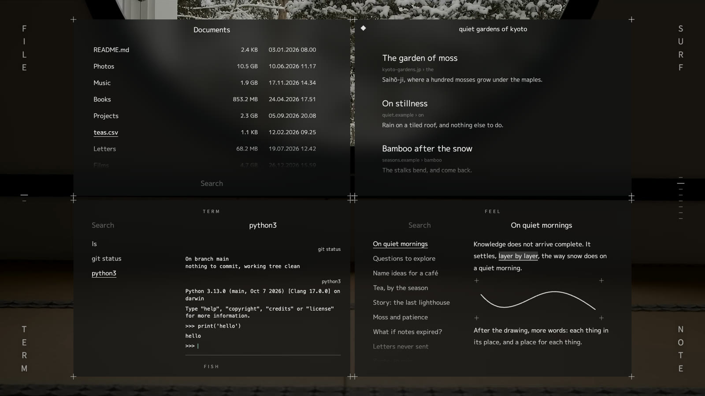
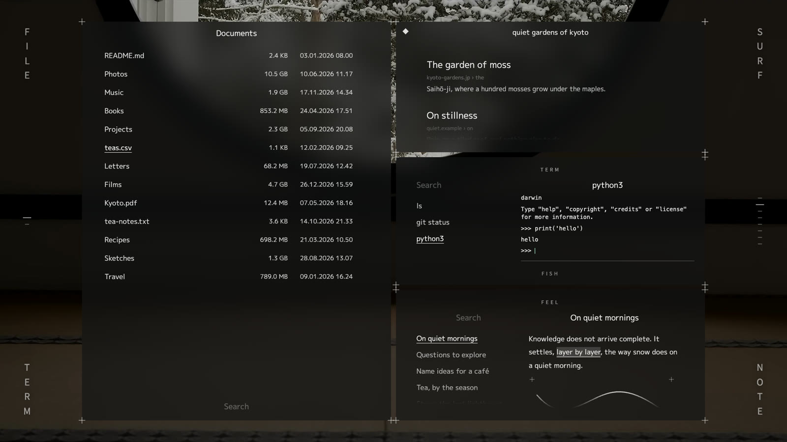
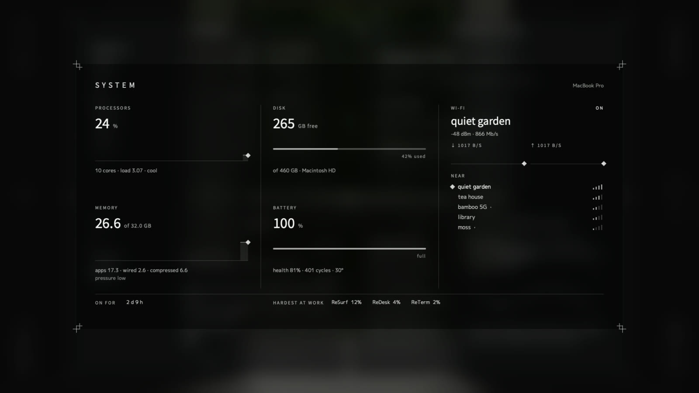
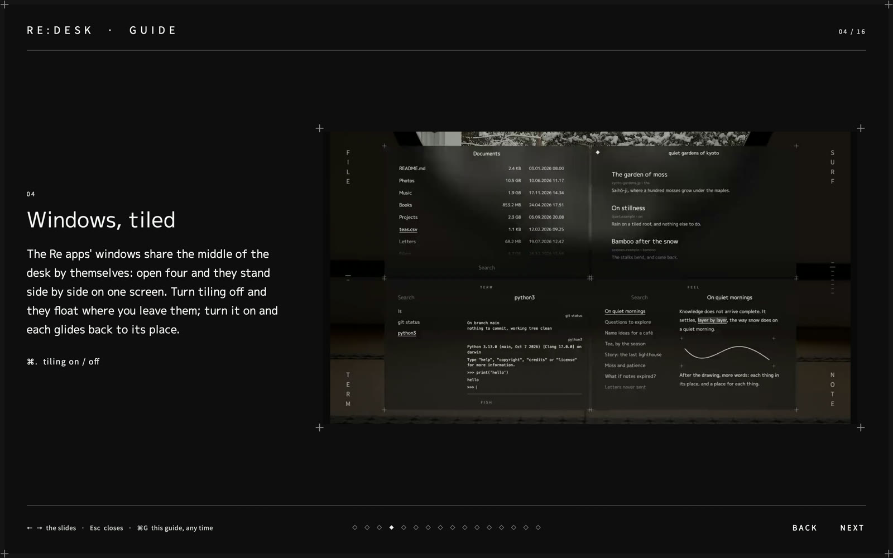
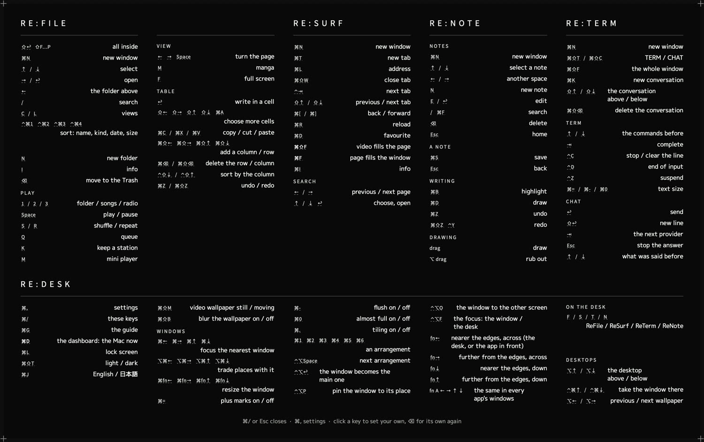
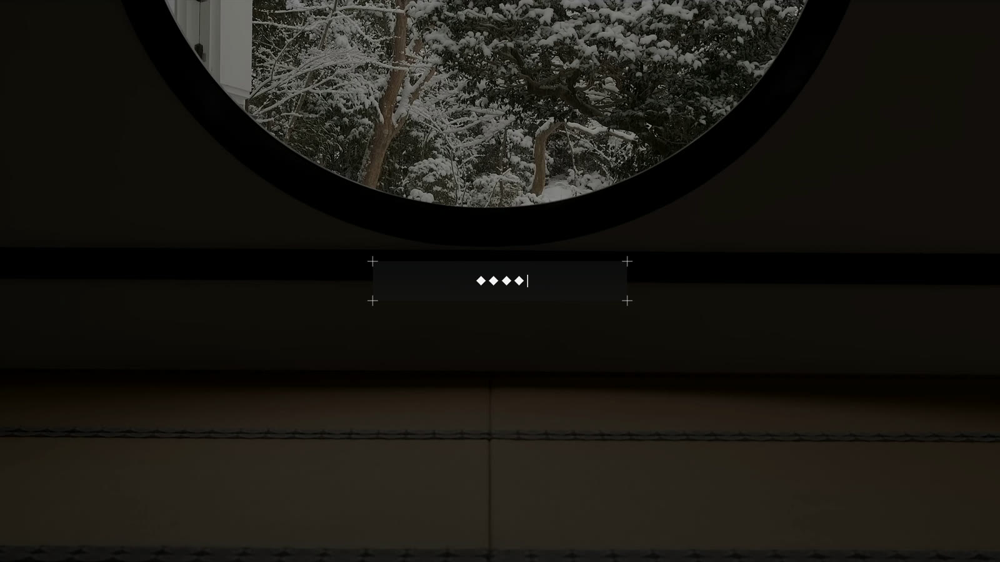

<div align="center">
  
  <h1>re: desk</h1>
  <p><em>Everything, laid out quietly</em></p>
  <p>The desk itself: the apps in its corners, their windows in its middle.</p>
  <p><a href="https://getrespace.app/download/ReSpace.dmg">Download for Mac</a> · <a href="https://getrespace.app">getrespace.app</a> · <a href="https://ko-fi.com/artursavytskyi">Support</a></p>
</div>

**re: desk** is the desk the other apps live on. Their names stand in its corners and their windows are tiled in its middle, on desktops of its own, on every screen. It turns the wallpapers, draws the cursors in ink, shows the Mac as it is now on a dashboard, locks the screen, and lets every key of every Re app be your own. A guide opens when it starts (⌘G brings it back).

<p align="center">
  <a href="https://getrespace.app">
    
  </a>
</p>

<details>
  <summary>📸 More pictures</summary>

| Arrangements | Dashboard |
| --- | --- |
|  |  |

| Guide | Own keys |
| --- | --- |
|  |  |

| Lock screen |
| --- |
|  |

</details>

## What it does

- **Tiling**: The apps' windows share the middle of the screen and glide when moved: six arrangements, ⌘1…⌘6, the golden spiral among them; Flush joins them into one glass.
- **Every screen**: An external display tiled too, each screen its own spacing; ⌃⌥O sends a window across.
- **Spacing**: fn and the arrows move the edges: the desk's, or the windows' of the app in front; with A held, every app the same.
- **Desktops**: Desktops of its own, one above another.
- **Wallpapers**: Pictures and films, from your Mac.
- **Ink cursors**: The Mac's cursors drawn with a brush.
- **Dashboard**: ⌃⌥D: the processors, memory, disk, battery and Wi-Fi, as they are now.
- **Focus**: ⌃⌥F: from the window to the desk, and back.
- **Lock screen**: A quiet lock screen: UNLOCK, and the password as diamonds.
- **Own keys**: Every key of every app can be your own (⌘/).
- **Guide**: A slide for each of these, when it starts and with ⌘G.

## Part of re: space

re: desk is one of five quiet apps for the Mac. Each is fine alone; all five together make one quiet desk.

| | App | |
| :---: | :--- | :--- |
|  | [**re: desk**](https://github.com/artyr1997/ReDesk) *(this one)* | the desk they live on |
|  | [**re: file**](https://github.com/artyr1997/ReFile) | files, and what is in them |
|  | [**re: surf**](https://github.com/artyr1997/ReSurf) | a browser that stays out of the way |
|  | [**re: term**](https://github.com/artyr1997/ReTerm) | a terminal that reads like a conversation |
|  | [**re: note**](https://github.com/artyr1997/ReNote) | notes, in four quiet rooms |

## Install

Download **[ReSpace.dmg](https://getrespace.app/download/ReSpace.dmg)** from [getrespace.app](https://getrespace.app): all five apps, signed and notarized by Apple, so they open without a warning. Open it and drag each app into **Applications**.

Native Swift and AppKit. Runs on **macOS 13 Ventura or later**, on Apple silicon and Intel (one universal app).

## Keys

**The desk**

| Key | Does |
| :--- | :--- |
| ⌘, | settings |
| ⌘/ | all the keys (click one to set your own) |
| ⌘G | the guide |
| ⌃⌥D | the dashboard |
| ⌘L | lock screen |
| ⇧⌘T | light / dark |
| ⌘J | English / 日本語 |
| ⇧⌘M | video wallpaper still / moving |
| ⇧⌘B | blur the wallpaper |
| F / S / T / N | ReFile / ReSurf / ReTerm / ReNote, with the desk in front |

**Windows**

| Key | Does |
| :--- | :--- |
| ⌘ arrows | focus the nearest window |
| ⌘⌥ arrows | trade places with it |
| ⌘fn arrows | resize the window |
| ⌘. | tiling on / off |
| ⌘1 … ⌘6 | an arrangement |
| ⌃⌥Space | next arrangement |
| ⌃⌥↩ | the window becomes the main one |
| ⌘- / ⌘0 / ⌘= | flush / almost full / plus marks |
| ⌃⌥P | pin the window to its place |
| ⌃⌥O | the window to the other screen |
| ⌃⌥F | the focus: the window / the desk |
| fn ← → / fn ↑ ↓ | spacing, across / down |
| fn A + arrows | the same in every app |

**Desktops**

| Key | Does |
| :--- | :--- |
| ⌥↑ / ⌥↓ | the desktop above / below |
| ⌘⌃↑ / ⌘⌃↓ | take the window there |
| ⌥← / ⌥→ | previous / next wallpaper |

## Build from source

With Xcode's command-line tools (Swift 5.9 or later) on macOS 13 or later:

```bash
./build.sh             # build/ReDesk.app, universal (arm64 + x86_64)
./build.sh --install   # and into Applications
```

Tiling and the keys take the **Accessibility** permission (macOS asks once). The dashboard's Wi-Fi names take **Location**, and the wave at the desk's foot listens to the Mac's own sound, not the microphone. `ReDesk --render-popups <folder>` draws the settings, the keys, the dashboard and every slide of the guide into pictures.

How it is made, in detail: [docs/DETAILS.md](docs/DETAILS.md).

## Support

re: space is made by one person, slowly and with care. If it makes your days a little calmer, you can [buy me a coffee on Ko-fi](https://ko-fi.com/artursavytskyi).
